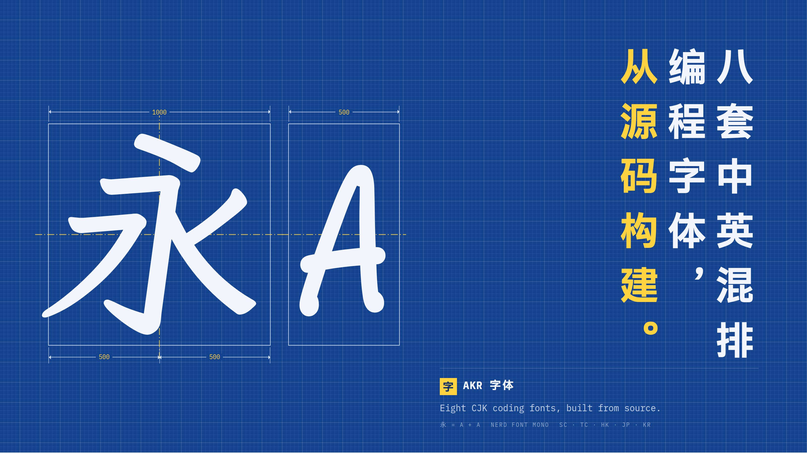

# font

**Eight CJK coding fonts, built from source, reproducibly.**

Latin designs married to CJK masters on a strict 2:1 grid, patched with Nerd
Font icons, hinted, gated and fingerprinted — every family is a Nix derivation,
and a release is built by the same command you run locally.

[Website](https://akr-font-site.vercel.app/en/) ·
[Preview in the browser](https://akr-font-site.vercel.app/en/preview) ·
[Download a release](https://github.com/AkaraChen/font/releases) ·
[License](#license--attribution)

<sub>The specimen above is set in the released `.ttf`s themselves, with each
family's 2:1 cells drawn behind 永安Ag — source:
[`docs/assets/specimen.html`](docs/assets/specimen.html).</sub>

## The eight families

| | family | Latin × CJK | dual width | weights |
| --: | --- | --- | --- | --- |
| 01 | **AKR Slab** SC NFM · [`serif/`](serif) | MonoSlab × 霞鹜新致宋 Opt | 2:1 | Regular · Bold |
| 02 | **AKR Sans** SC NFM · [`sans/`](sans) | Lilex × IBM Plex Sans SC | 550 / 1100 | Regular · Bold |
| 03 | **AKR Round** SC NFM · [`rounded/`](rounded) | Iosevka Curly × Resource Han Rounded | 500 / 1000 | Regular · Bold |
| 04 | **AKR Type** SC NFM · [`typewriter/`](typewriter) | Courier Prime × 朱雀仿宋 Zhuque | 600 / 1200 | Regular · Bold |
| 05 | **AKR Pixel** SC NFM · [`pixel/`](pixel) | Fusion Pixel 12px × Fusion Pixel 12px | 2:1 | Regular |
| 06 | **AKR Hand** SC NFM · [`handwriting/`](handwriting) | Monaspace Radon × 霞鹜文楷 LXGW | 500 / 1000 | Regular · Bold |
| | **AKR Hand** SC Text · [`handwriting/`](handwriting) | Monaspace Radon × 霞鹜文楷 LXGW | reading face | Light · Regular · Bold |
| 07 | **AKR Casual** SC Dual · [`casual/`](casual) | Recursive Mono Casual × Yozai 悠哉 | 2:1 | Regular · Bold |
| 08 | **AKR DWG** SC NFM · 大弯勾 · [`dwg/`](dwg) | Cascadia Code (Nerd Fonts v3.5.1) × 阿里巴巴普惠体 3.0 | 500 / 1000 | Light · Regular · Bold |

Every product is named **`AKR <Style> <Region> <Variant> [<Weight>]`**.
`<Region>` is a build axis, not a separate recipe: `SC` `TC` `HK` `JP` `KR` come
out of one Latin build and several CJK masters. `<Variant>` is `NFM` (Nerd Font
Mono coding face), `Text` (reading face) or `Dual` (dual-width coding face with
no icons).

Some of the things a family does are measured rather than guessed —
handwriting shears its CJK **7.5°** to match Radon's lean and pairs Light with
WenKai *Regular*, typewriter emboldens Zhuque by stem width, pixel pixelizes the
`calt` ligatures but not the Nerd icons.

## Docs

- [`docs/build-toolchain.md`](docs/build-toolchain.md) — how the derivations fit together
- [`docs/caching.md`](docs/caching.md) — what is cached, and what invalidates it
- [`docs/naming-migration.md`](docs/naming-migration.md) — moving a config off the pre-`AKR` family names
- each family's own README — the design decisions behind that face

## Build one

The toolchain is pinned by a Nix flake; `just` is a thin alias layer over it.
Nothing to install first, no per-family build script to run by hand.

```bash
just dev                     # the pinned shell: fontforge, ttfautohint, afdko, node, python
just build sans              # → sans/out/nerd/AKRSansSCNFM-{Regular,Bold}.{ttf,woff2}
just build sans coding tc    # one matrix cell
just matrix                  # every (family, profile, region) cell there is
just --list                  # everything else
```

And the checks that stand between a build and a release:

```bash
just gate sans               # the family's 2:1 / EAW / Nerd / OT-feature gate
just verify sans             # diff the products against the committed fingerprint baseline
just release sans coding sc  # the release zip (depends on the gate)
just notes sans coding sc    # the release notes that zip ships with
```

<details>
<summary><b>Formats</b> — <code>.ttf</code>, <code>.woff2</code>, <code>.otf</code>, and why they are not interchangeable</summary>

The `.ttf` is the product. The others are derived from it and are not
interchangeable with it:

| format | what it is | who wants it |
| --- | --- | --- |
| `.ttf` | TrueType outlines, hinting intact | everyone — editors, terminals, desktop |
| `.woff2` | the **same outlines**, Brotli-compressed. Byte-identical `glyf` data, gated as such on every build | `@font-face` on the web |
| `.otf` | PostScript/CFF, converted with qu2cu: curves refit within 1 font unit, **hinting dropped**, contours reversed | print / design tools that want CFF |

Which cells ship which is `[[build.matrix]]` in each `font.toml`; `just matrix`
prints it. The defaults are `coding = ttf + woff2` and `text = ttf + woff2 +
otf` — a coding face is hinted and lives in an editor, so an unhinted CFF
version of it would be a worse file in a nicer-sounding format, while a reading
face also gets set in print. The OTF carries its own fingerprint baseline, for
the same reason it is a separate product rather than a repackaging.

</details>

<details>
<summary><b>Naming</b>, in one table — name IDs 1 / 2 / 16 / 17 and the 31-character budget</summary>

Three weights need name IDs 16/17: Windows' name ID 2 understands only
`Regular` / `Italic` / `Bold` / `Bold Italic`, so a `Light` cannot live there.

| name ID | Light | Regular | Bold |
| --- | --- | --- | --- |
| 1 (family, ≤ 31 chars) | `AKR Hand SC Text Light` | `AKR Hand SC Text` | `AKR Hand SC Text` |
| 2 (subfamily) | `Regular` | `Regular` | `Bold` |
| 16 / 17 | `AKR Hand SC Text` / `Light` | … / `Regular` | … / `Bold` |

`font.toml` stores the *segments*, never the finished string, and the
31-character budget — measured against the longest weighted name ID 1 a matrix
cell can produce — is checked at manifest-load time rather than discovered in a
font menu.

</details>

## License & attribution

Recipes and tooling: [MIT](LICENSE). The fonts they build are derivatives of
their upstreams and, except `dwg/`, ship under **SIL OFL 1.1**. `dwg/`'s CJK
donor (Alibaba PuHuiTi) stays under Alibaba's own legal notice — not OFL — and
that notice is recorded next to the recipe. Upstream attribution lives in name
ID 5, name ID 10, each family's README, and the release notes.

Upstreams, with thanks: [Iosevka](https://github.com/be5invis/Iosevka) ·
[Monaspace](https://github.com/githubnext/monaspace) ·
[Lilex](https://github.com/mishamyrt/Lilex) ·
[IBM Plex](https://github.com/IBM/plex) ·
[Recursive](https://github.com/arrowtype/recursive) ·
[Courier Prime](https://github.com/quoteunquoteapps/CourierPrime) ·
[Sarasa Gothic](https://github.com/be5invis/Sarasa-Gothic) ·
[LXGW WenKai](https://github.com/lxgw/LxgwWenKai) ·
[LXGW NeoZhiSong](https://github.com/lxgw/LxgwNeoZhiSong) ·
[朱雀仿宋 Zhuque](https://github.com/TrionesType/zhuque) ·
[Yozai](https://github.com/lxgw/yozai-font) ·
[Fusion Pixel](https://github.com/TakWolf/fusion-pixel-font) ·
[Resource Han Rounded](https://github.com/CyanoHao/Resource-Han-Rounded) ·
[Nerd Fonts](https://github.com/ryanoasis/nerd-fonts) ·
[Cascadia Code](https://github.com/microsoft/cascadia-code) ·
[阿里巴巴普惠体](https://www.alibabafonts.com)
